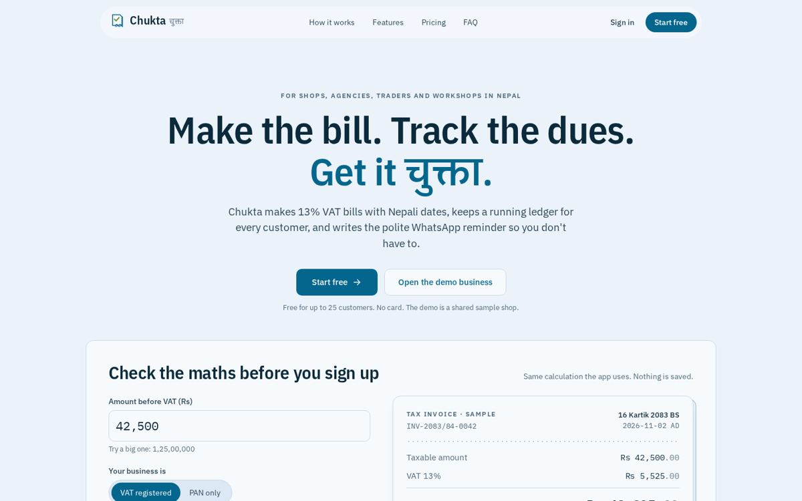
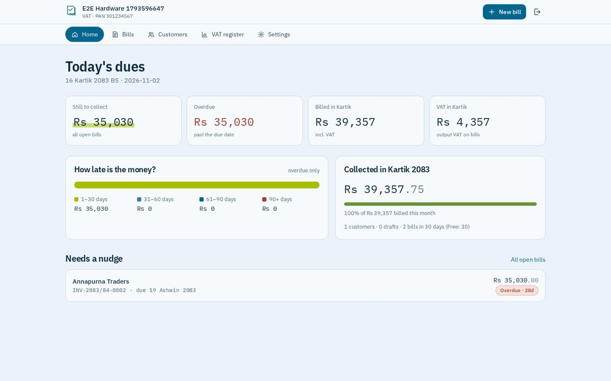
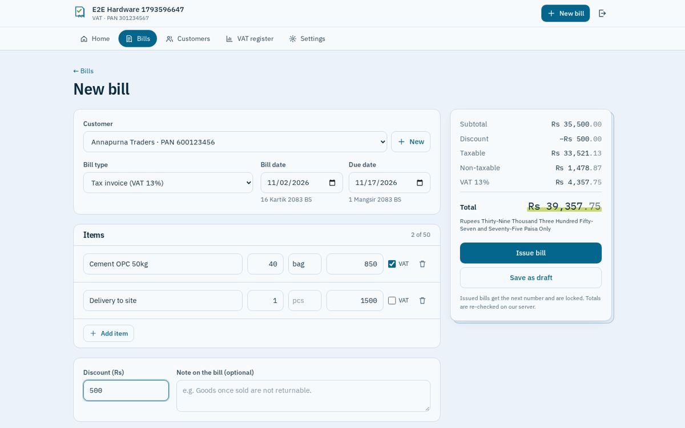
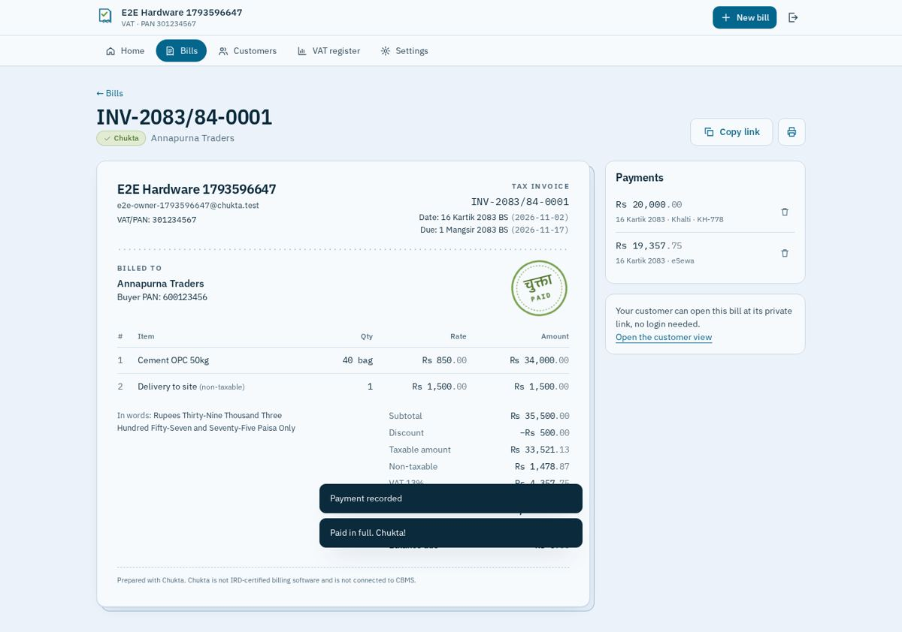
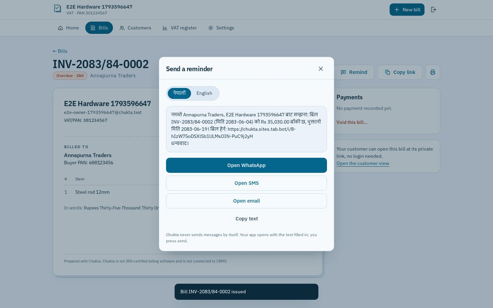
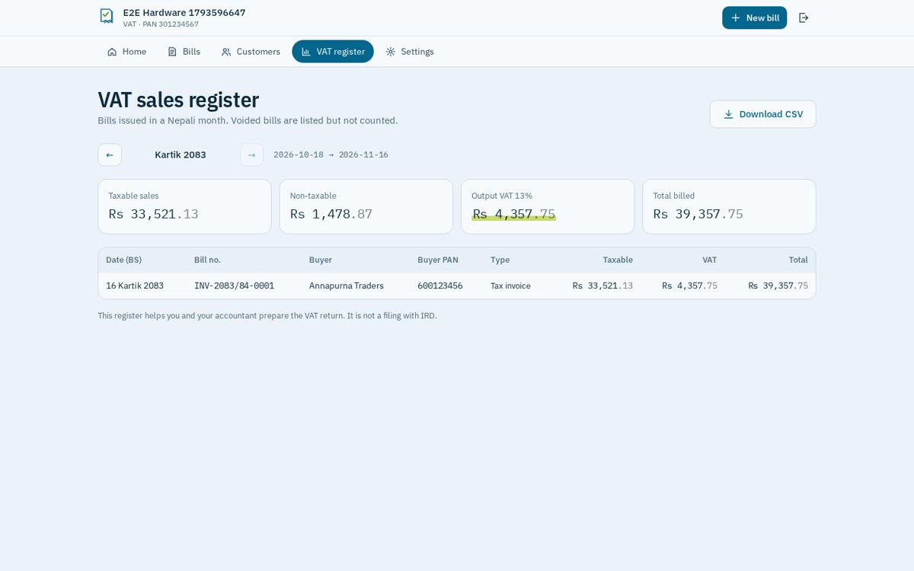
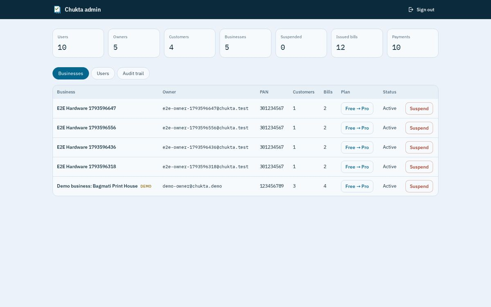
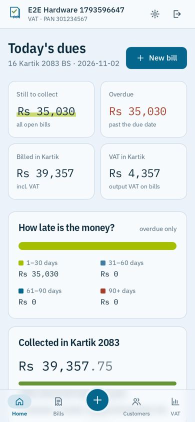
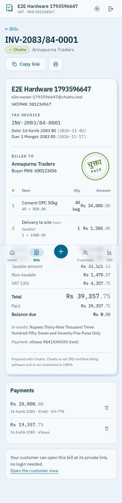

# Chukta (चुक्ता)

**VAT-ready bills and receivables for Nepali small businesses.** Make a 13% VAT bill with Bikram Sambat dates in a minute, see every rupee owed and how late it is, keep a running ledger per customer, and send a polite Nepali or English payment reminder on WhatsApp with a link to the bill.

Day 2 of Nabin's **100 Days · 100 Platforms**.

- **Live:** https://chukta.sites.tab.bot/
- **Demo:** https://chukta.sites.tab.bot/login?demo=1 (shared sample business; owner `demo-owner@chukta.demo`, buyer `demo-buyer@chukta.demo`, password shown on that page)

> Chukta is **not IRD-certified billing software** and is not connected to CBMS. Businesses that are legally required to use certified billing software must use it for official tax invoices. Every bill Chukta prints says so.



## What it does
- **Bills:** tax invoice (13% VAT), abbreviated tax invoice (up to Rs 10,000) or PAN bill for non-VAT businesses. Taxable/non-taxable lines, pro-rata discount, amount in words (lakh/crore), BS + AD dates. Totals are always recomputed on the server.
- **Numbering:** `PREFIX-2083/84-0001`, sequential per Nepali fiscal year (from 1 Shrawan). Issued bills are locked; mistakes are voided with a reason (kept in the register).
- **Receivables:** Due → Overdue (days counted) → Chukta (paid stamp). Dashboard with aging (1–30/31–60/61–90/90+ days), collected vs billed this month, bills that need a nudge.
- **Payments:** partial or full, cash/bank/eSewa/Khalti/Fonepay/cheque, reference numbers; remove a wrong entry.
- **Reminders:** Nepali or English text with the balance and bill link; opens WhatsApp (+977), SMS or email. Nothing is sent automatically.
- **Ledger:** per-customer statement with running balance, CSV export.
- **VAT sales register:** any BS month, taxable/non-taxable/VAT totals, void bills listed but not counted, CSV for the accountant.
- **Customer portal:** buyers who sign up with the email on their customer record see all bills addressed to them.
- **Public bill link** (`/i/<token>`) printable / save as PDF.
- **Admin:** platform overview, businesses (suspend, Free/Pro), users (disable, which ends sessions), audit trail.

| | |
|---|---|
|  |  |
|  |  |
|  |  |

<p> </p>

## Stack
- React 18 + Vite + TypeScript + Tailwind CSS (no UI kit; own icon set), lazy-loaded routes.
- One **Cloudflare Worker** serves the API (`/api/*`) and the static app; **Cloudflare D1** (SQLite) is the database. D1 replaces PostgreSQL/Prisma so the whole thing runs at **$0** on the free tier.
- Own auth: PBKDF2-SHA256 (WebCrypto), hashed session tokens in HttpOnly/Secure/SameSite cookies, CSRF checks, rate limits, roles **customer / owner / admin**.
- Shared money + date maths (`shared/money.ts`) used by both API and browser; BS calendar from Nabin's own [`nepali-date`](https://github.com/nabinbabuuranw/nepali-date) library (MIT).
- Fonts: IBM Plex Sans, Plex Sans Devanagari, Plex Mono (SIL OFL), self-hosted.
- Palette: Coolors "Sky Blue Freshness" `#05668D #427AA1 #EBF2FA #679436 #A5BE00` (see `docs/DESIGN.md`).

## Run it
```bash
npm install
npm test            # 24 API tests (Node 22.6+, uses node:sqlite)
npm run build       # tsc + vite build + bundles the Worker into dist/site
```
`dist/site` is a Cloudflare Worker with static assets (`_worker.js`, `tab-site.json` declares one D1 binding `DB`). The schema is created on first request. To create the first admin, POST `/api/setup` with a setup key whose SHA-256 matches `SETUP_KEY_SHA256` (set your own via the env var of the same name; the production key is not in this repo).

Live E2E (Python Playwright): `python3 e2e/e2e.py OUT_DIR creds.json` with `{"admin":{"email","password"}}` for your own deployment.

## Docs
- `docs/DESIGN.md` — research, UI UX Pro Max output, 21st.dev references, Coolors palette, type, tokens, layout.
- `docs/BUSINESS.md` — customers, competitors, pricing (Free / Pro Rs 799 per month), acquisition, costs.
- `docs/QA_REPORT.md` — tests, live E2E, 30-point anti-AI audit, known limitations.

## Status
Expenses: $0. Revenue: Rs 0. Built 2 November 2026.

## License
MIT © 2026 Nabin Uranw
